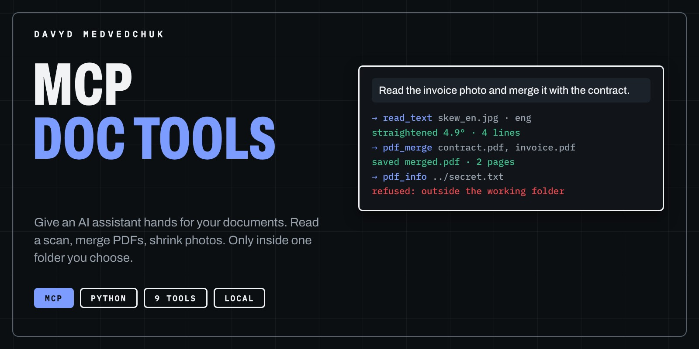

# MCP Doc Tools



> **Test version.** Every tool was tested here through a real MCP client, but the server has not yet been tried inside Claude Desktop or on Windows. Expect rough edges and please report them.

An [MCP](https://modelcontextprotocol.io) server that gives an AI assistant hands for your documents: read a scan, work with PDFs, shrink photos. It runs on your computer. Nothing is uploaded, and the assistant can only touch **one folder you choose**.

## Tools

| Tool | What it does |
|---|---|
| `list_files` | PDFs and images in the folder, with sizes |
| `pdf_info` | Pages, size, whether it has selectable text (scan or not) |
| `pdf_text` | Text of a PDF, by page range |
| `pdf_merge` | Join PDFs in a given order |
| `pdf_extract_pages` | Keep only some pages, e.g. `2-4,7` |
| `pdf_compress` | Smaller (150 dpi) or smallest (100 dpi). Says so when a file cannot get smaller |
| `read_text` | OCR for scans, photos and scanned PDFs. Straightens and cleans the page first. English, Portuguese, Russian, Ukrainian and any other Tesseract language |
| `clean_scan` | Straighten a photo and make it black and white |
| `shrink_photo` | Smaller JPEG, HEIC from an iPhone works |

The scan clean-up is the same method as in [Local OCR](https://github.com/davydmedvedchuk/local-ocr) (adaptive threshold, then deskew by projection profile).

## Safety rules

- Every path is resolved inside the working folder. `../`, absolute paths and symlinks that point outside are refused, and the assistant sees why.
- Nothing is overwritten. A result gets a new name (`merged.pdf`, then `merged-2.pdf`) and the tool returns it.
- Original files are never changed. There is no delete tool.
- No network calls.

## Install

You need Python 3.10+ and the Tesseract program with the languages you want (`apt install tesseract-ocr tesseract-ocr-por tesseract-ocr-rus`, or `brew install tesseract tesseract-lang`).

```
pip install git+https://github.com/davydmedvedchuk/mcp-doc-tools
```

## Connect it to Claude Desktop

Add this to `claude_desktop_config.json` (Settings → Developer → Edit config) and restart the app. Put your own folder in `DOC_TOOLS_ROOT`.

```json
{
  "mcpServers": {
    "doc-tools": {
      "command": "doc-tools",
      "env": { "DOC_TOOLS_ROOT": "/Users/you/Documents/scans" }
    }
  }
}
```

If `doc-tools` is not found, use the full path of the command (`which doc-tools`) or `"command": "python3", "args": ["-m", "doc_tools"]`.

Then ask in plain words: *"Read invoice.jpg in Portuguese and tell me the total."* or *"Merge contract.pdf and annex.pdf, then make it smaller."*

## Tests

```
pip install -e ".[test]"
python3 -m pytest tests/                                  # folder guard, never-overwrite, page ranges
DOC_TOOLS_ROOT=/folder/with/samples python3 tests/smoke.py   # starts the real server and calls every tool
```

## Limits

- `pdf_compress` turns pages into images, so the text is no longer selectable. Use `read_text` on the result if you need the words.
- OCR reads printed text. Handwriting and blurry photos come out poorly.
- Password-protected PDFs are refused, not opened.
- Built on the MCP Python SDK 2.x (`mcp.server.mcpserver`).

Made by Davyd Medvedchuk. MIT licence.
